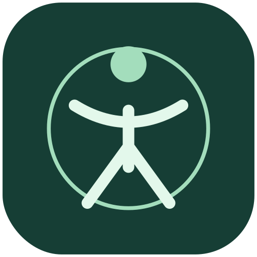

# HumanCraft



**Design for humans, not just screens.** · [简体中文](README.zh-CN.md)

A human-centered design skill for AI agents, informed by Donald Norman's design psychology and modern UX engineering. Move beyond visual polish: design real user outcomes, clear workflows, recoverable mistakes, accessible controls and honest automation. Works alongside existing coding and visual design skills.

**v0.6.0 — public preview.** This repository contains the development source and public synthetic benchmark. The engineering tests are reproducible, but independent model uplift and actual human usability remain unmeasured. This is not a usability certification or a claim of competition placement.

## Quick start

Copy the entire `skills/humancraft/` directory into your client's supported Agent Skills folder, or import its ZIP if supported. Compatible installers may support `npx skills add linsky-dev/HumanCraft --skill humancraft`. Client-specific discovery and import have not been independently verified. No network, Python runtime or third-party API is required for the core instructions; optional local scripts use Python's standard library.

Try: **“Use HumanCraft to audit and improve our batch import flow. Preserve existing features, identify the root causes, define unchanged acceptance tests, and verify actual state and recovery.”**

## What makes it different

- Task-appropriate depth: quick for small edits, standard for features, critical for consequential workflows.
- Human-centered discovery, visual craft, interaction, complexity management, resilience and human–AI control.
- Twelve behavior contracts, independent acceptance checks, evidence firewall and honest handoff.
- Eighteen reference files including source notes; 44 behavior cases and 24 activation prompts; optional evidence scoring and trace checking.
- Public synthetic workflow lab, frozen four-arm agent comparison, and a human research protocol. No telemetry or hidden network calls in the core skill.

## Evidence, not claims

| Check | v0.6 result |
|---|---|
| Unit tests | 77/77 passed locally |
| Eight Chromium development workflows | 64/64 expected outcomes; original seeded faults vs handcrafted reference, offline DOM only |
| Independent model comparisons | NOT RUN |
| Human participants | NOT RUN |
| Live backend and persistent state, cross-browser and client install | Not established |

See [validation](docs/VALIDATION-v0.6.md), [public raw results](bench/evidence-v06/calibration/results.json), [benchmark protocol](bench/README.md), [human study](docs/HUMAN-STUDY.md), and [release gates](docs/RELEASE-GATES.md). Historical test records are retained; do not pool them as independent observations.

## Reproduce

```sh
python -m pip install PyYAML==6.0.3
python scripts/validate.py
python -m unittest discover -s tests -v
python -m pip install -r benchmark/requirements.txt
python -m playwright install chromium
python bench/verify.py --calibrate --output local-eval-results/calibration
```

Use `python scripts/package.py --output dist` to build the standard skill archive and full source archive with SHA-256 checksums. Do not execute arbitrary agent submissions outside an independently isolated environment. See [contributing](CONTRIBUTING.md) and [security](SECURITY.md).

## License and attribution

MIT for original project code and documentation (maintainer to confirm before publication). Referenced research and third-party works retain their own rights. See [LICENSE](LICENSE) and [sources](skills/humancraft/references/sources.md). No book PDF, publisher material or endorsement is included. Candidate brand name has not undergone trademark clearance.
