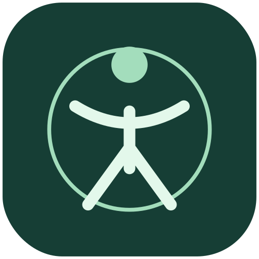

# HumanCraft · 人本设计智能体技能集



**为真实的人设计，而不只是为屏幕设计。** [English](README.md)

基于诺曼设计心理学与现代 UX 工程，帮助 AI 设计更合理的产品、系统、功能、界面及人机协作流程。除了视觉审美，更重视任务完成、异常恢复、数据一致性、权限和用户控制权。

当前版本 **v0.6.0 公开预览版**。本仓库包含完整开发源码及公开合成评测。独立 AI 模型增益和真实用户体验尚未测量，不宣称已达到冠军水平或获得可用性认证。

## 安装使用

完整导入 `skills/humancraft/` 目录（支持 ZIP 的客户端可导入标准技能包），不要只复制 SKILL.md。兼容客户端可尝试 `npx skills add linsky-dev/HumanCraft --skill humancraft`。实际安装和自动触发尚待独立客户端验证。核心技能不要求联网、额外运行时或 API 密钥。

提示示例：“使用 HumanCraft 审查并改善系统批量导入功能，核实问题根因，保留已验证功能，冻结验收条件，验证数据状态及异常恢复。”

## 核心能力

风险分级、需求探索、交互及视觉设计、复杂流程、情感体验、无障碍、防错恢复、人机协作、12 项行为契约、证据防火墙、独立验收方法。18 份参考文件（含来源说明），44 个行为案例、24 个触发样本，可选本地评分和事件检查工具。

## 本轮证据

- 77/77 项单元测试通过；8 个公开合成交互任务共 64/64 项 Chromium 检查符合预期。
- 人为预置缺陷与参考修复的对照，不等于独立 AI 实验。当前没有真实参与者数据，也未建立真实服务端持久化、跨浏览器和客户端安装通过的证据。
- 原始实验记录：[结果 JSON](bench/evidence-v06/calibration/results.json)、[验证说明](docs/VALIDATION-v0.6.md)、[评测协议](bench/README.md)、[真实用户研究](docs/HUMAN-STUDY.md)。

## 复现

```sh
python -m pip install PyYAML==6.0.3
python scripts/validate.py
python -m unittest discover -s tests -v
python -m pip install -r benchmark/requirements.txt
python -m playwright install chromium
python bench/verify.py --calibrate --output local-eval-results/calibration
python scripts/package.py --output dist
```

## 社区和版权

参见 [贡献指南](CONTRIBUTING.md)、[安全报告](SECURITY.md)、[发布门禁](docs/RELEASE-GATES.md) 和 [LICENSE](LICENSE)。建议对原创代码和文档采用 MIT，公开前由维护者确认。原书、原书插图以及大段翻译不进入公开仓库；第三方知识产权仍归其权利人。品牌名称尚未完成商标清查。
